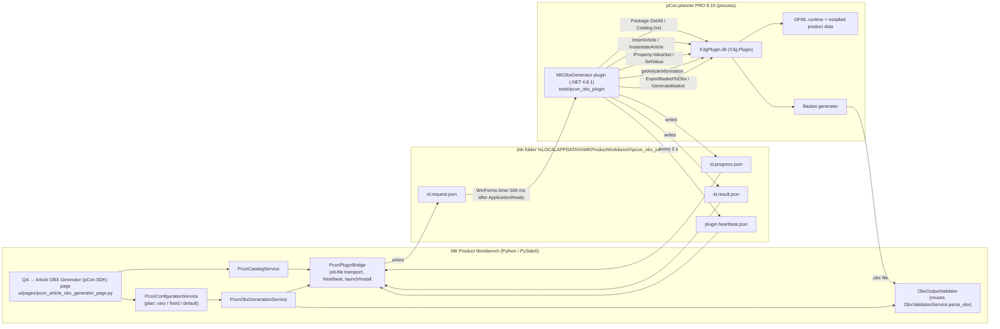

# pCon.planner Plugin SDK 8.15 → QA Article OBX Generator

**Status:** CURRENT · **Date:** 2026-10-30 · **Scope:** SDK investigation and implementation reference for `QA → Article OBX Generator (pCon SDK)`.

**Evidence base** (all files inside `pcon.planner_plugin_sdk_8.15 (1).zip`, extracted root `pCon.planner Plugin SDK/`):

| Source | Used for |
|---|---|
| `Getting Started.pdf` (6 pages, "Version 8.14") | architecture, registration, installation, loading, plugin structure |
| `Documentation/pCon.planner Plugin SDK.pdf` (468 pages) and `Documentation/html/*.html` (1,376 files, Doxygen "Version 8.14") | every class/method cited below |
| `Documentation/PluginInfo.xsd` | plugin manifest schema |
| `ReleaseNotes.txt` | API deltas up to 8.14 (3.20.0.0) |
| `SamplePlugin/*.cs`, `SamplePlugin/res/SamplePlugin.xml`, `SamplePlugin/res/SamplePlugin.ui`, `SamplePlugin/SamplePlugin.csproj` | working examples |
| `SamplePlugin/X3gPlugin/X3gPlugin.dll` (file version 1.20.0.19838, assembly 3.20.0.0) and `Plugin Binaries/SamplePlugin/*` | the only assembly in the SDK |
| Installed `C:\Program Files\EasternGraphics\pCon.planner PRO\bin\X3gPlugin.dll` (file version 1.20.0.19898, assembly 3.20.0.0, AMD64) and `planner_pro.exe` 8.15.0.1527 | compile target; the SDK says to reference the installed copy |

Everything below that is marked **confirmed** was read in those files or compiled against the installed assembly. Items marked **assumption** or **unverified** could not be checked without a running, licensed plugin.

---

## A. SDK overview

| Aspect | Finding | Evidence |
|---|---|---|
| Nature | In-process plugin API. A plugin is a .NET class library that pCon.planner loads at start-up and calls back through `X3g.Plugin.Plugin`. | Getting Started §2, §5; `Plugin` class doc |
| Platform | Microsoft .NET Framework 4.8.1 (SamplePlugin targets `v4.8.1`). Managed C++/CLI-style API surfaced to C#. | Getting Started §2; `SamplePlugin.csproj` |
| Languages | C# (sample), any .NET language. There are **no** C++ samples, no COM interfaces, no command-line, HTTP or socket interface in the SDK. | whole SDK tree; grep of the manual for "command line", "COM", "automation" returned nothing |
| Assembly | `X3gPlugin.dll` (namespace `X3g.Plugin`, sub-namespaces `Articles`, `IO`, `Layout`, `Modeling`, `Room`, `Tool`) plus `X3gPlugin.xml` IntelliSense. | `namespace_x3g_1_1_plugin.html` |
| Threading | "The plugin interface is not threadsafe. Direct calls are only allowed from the plugins main thread, otherwise `Invoke()` needs to be used." | `Plugin.Invoke` doc |
| Start-up rule | "A plug-in must not do any significant processing when it is loaded … Processing can be done after the event `EventType::ApplicationReady`." | Getting Started §5; `Plugin.X3gInitialize` doc |
| Registration / licensing | A plugin needs a hash issued by EasternGraphics (`<plugin hash="…">` and `X3gGetGlobalIdentifier()` must match). Hash `"0"` is accepted only on a machine with a time-limited **Plugin SDK developer licence**; such plugins "will not run outside the machine containing the developer license". Registration requests go to `request@easterngraphics.com`. | Getting Started §3, §8 |
| Installation | `<ProgramData>\EasternGraphics\<APP>\plugins`, `<USER>\AppData\Roaming\EasternGraphics\<APP>\plugins` (`<APP>` = `pCon.planner Pro` or `pCon.planner`), the application `plugins` sub-folder (development only), or a folder registered under `HKLM/HKCU\SOFTWARE\EasternGraphics\X3GPlugins`. Plugin files live in a sub-folder named after the plugin: `<name>.dll`, `<name>.xml`, optional `<name>.ui`. | Getting Started §4, §9.1 |
| Manifest | `PluginInfo.xsd`: `<plugin id version hash baseAPIVersion vendorName>` with `<dependencies><module name="core|planner" minVersion/>` and `<edition key supported/>`. Installed vendor plugins use `baseAPIVersion="3"`, `core ≥ 1.16.0`, `planner ≥ 8.10`. | `PluginInfo.xsd`; `plugins/X3G-CSV-Export/X3G-CSV-Export.xml` on this machine |
| Support | No free support; `support@easterngraphics.com`. Interfaces may change; undocumented members (e.g. property keys) may change without notice. | Getting Started §7, §10 |

**Consequence for MK Product Workbench (Python/PySide6):** the Workbench cannot call the SDK directly. Any SDK-based workflow needs (1) a plugin running inside pCon.planner and (2) a transport between the Workbench process and that plugin. The SDK is silent on (2); it is an application-level decision (see §F).

---

## B. Relevant APIs

All names are `X3g.Plugin.*` unless stated. Signatures were confirmed against `X3gPlugin.xml` of the installed planner and by compiling `tools/pcon_obx_plugin` against it.

### B.1 Plugin host (`class Plugin`, abstract)

| Member | Purpose |
|---|---|
| `string X3gGetGlobalIdentifier()`, `X3gGetName()`, `X3gGetVendor()`, `X3gGetDescription()`, `X3gGetVersion()` | identity; must match the manifest XML |
| `bool X3gInitialize(string pluginPath)` | register actions; return `false` to refuse loading |
| `void X3gEvent(EventType type, object parameter)` | `EventType.ApplicationReady`, `ApplicationWillTerminate`, `DocumentNew`, `DocumentOpened`, `DocumentWillClear`, `DocumentSelectionChanged`, `DocumentEntitiesAdded`, … |
| `void X3gAction(string actionKey, string arguments)` | invoked for actions registered via `IActionManager.RegisterAction` and triggered from the `.ui` manifest or `IActionManager.ExecuteAction` |
| protected fields `X3gActions : IActionManager`, `X3gApp : IAppManager`, `X3gArticles : IArticleManager`, `X3gUndo`, `X3gUtils`; properties `Document : DocumentManager`, `Geometry`, `Log : Logger`, `Windows`, … | service access |
| `void Invoke(SendOrPostCallback, object, bool wait)` | marshal to the plugin main thread |

### B.2 Catalogue access (`X3g.Plugin.Articles`)

| Member | Signature | Notes |
|---|---|---|
| `Package.GetAll()` | `static IList<Package>` | all registered OFML packages |
| `Package.Get(string packageName)` | `static Package` | `null` if unknown |
| `Package` properties | `Manufacturer` (OFML id, e.g. `egr`), `ManufacturerId` (commercial id, e.g. `EG`), `Program` (OFML series id), `ProgramIds` (commercial product lines, `;`-separated, e.g. `AX;BX`), `ProgId`, `DistributionRegion`, `Version`, `VersionedName` (e.g. `::egr::office2::1`), `Type : PackageType` (`Unknown, Found, Product, ProductWithCatalog, Catalog`), `DataDir`, `PackageDir`, `Path`, logos | `GetManufacturerName(lang)`, `GetProgramName(lang)`, `GetLanguages()`, `GetValue(key, lang)` (DSR profile), `GetCatalogPackages()` |
| `Catalog.GetAll()` / `Catalog.Get(Package)` | `static IList<Catalog>` / `static Catalog` | "may keep multiple files open … dispose via `using()`" |
| `Catalog.RootItem`, `Catalog.GetAllItems()` | `CatalogItem` / `IList<CatalogItem>` | `GetAllItems()` "includes invisible items which are not referenced from catalog tree" |
| `CatalogItem` | `Type : CatalogItemType` (`Unknown, Article, Folder, Information, MethodCall, FunctionCall, MetaPlanning, Graphics`), `ArticleNumber`, `VariantCode`, `VariantKey` (added 8.14), `PackageName`, `InCatalogTree`, `GetChildren()`, `GetText(CatalogTextPurpose.Label|Description)`, `GetImage(...)`, `GetResource(...)` | article discovery |

### B.3 Article creation and configuration

| Member | Signature | Notes |
|---|---|---|
| `IArticleManager.InsertArticle` | `IArticleEntity InsertArticle(string manufacturerId, string seriesId, string baseArticleNumber, string variantCode, bool keepInstanced)` (+ overload with `ArticleGeometryMode`) | "If pKeepInstanced is true the article will stay instantiated. This will speed-up a subsequent call to `InstantiateArticle()`." |
| `IArticleManager.InsertArticleByPackage` | `Articles.ArticleEntity InsertArticleByPackage(string catalogPkgName, string articlePkgName, string articleNumber, string variantCode, bool keepInstanced, ArticleGeometryMode geoMode)` | package-addressed insert; `geoMode = Undefined` applies the user setting |
| `IArticleManager.PrepareArticleEntities()` / `GetArticleEntity(string entityId)` / `IsArticle(string)` | | `PrepareArticleEntities` "needs to be called once before using" `GetArticleEntity` |
| `IArticleManager.InstantiateArticle` | `IArticleInstance InstantiateArticle(IArticleEntity article, ReadOnlyCollection<string> additionalLang)` | "Intantiates the given article and selects it to give access to its properties." Throws `System.Exception` on failure. Only one valid instance at a time (`IArticleInstance.IsValid`). |
| `IArticleInstance` | `PropertyProvider : IPropertyProvider`, `getArticleInformation(bool prepareImages) : IBasketItem`, `SetArticleTextField(id, lang, text)`, `Close()`, `IsValid`, `MainEntityId`, `EntityId`, `AvailableLanguages`, `IsAlternatePosition` | `Close()` "applies all changes"; the instance is also closed when another article is instantiated or deselected |
| `Articles.OfmlArticleInstance` (newer API) | `RootObject`, `SelectedObject`, `GetObject(name)`, `SetSelectedObject(OfmlObject)`, `ApplyChanges()`, `SetObjectStateModified()` | OFML object tree of a configuration |
| `Articles.OfmlObject` | `IsArticle()`, `IsA(type)`, `HasMember(name)`, `CallMethod(name, args, out result)`, `GetChildren(elementsOnly)`, `GetParent()` | direct OFML method calls (escape hatch, not used) |
| `Articles.OfmlEval.Eval(string expression)` | `string` | evaluate an OFML expression |
| `IPropertyProvider` (inherits `PropertyProvider`) | `GetProperties() : ReadOnlyCollection<IProperty>`, `GetProperty(key) : IProperty`, `BeginChangeSection()/EndChangeSection()`, `Update(valuesOnly)`, event `PropertiesChanged` | |
| `IProperty` | `Key`, `Name`, `Description`, `Type : PropertyType` (`Bool, Int, String, Double, Color, Length, Choice, Text, Currency, Font, Group, Image, Area`), `State : PropertyState` (flags `Null, Enabled, Hidden, Editable, ReadOnly`), `Value : PropertyValue`, `ValueSet : ReadOnlyCollection<PropertyValue>`, `SetValue(PropertyValue, bool undoable) : bool`, `Hide()/Unhide()` | **Key sentence** (SetValue doc): "Changing the value of a property may also change the state and the value of other properties if they depend on each other. Changing the value may even add new properties. Therefore, `IPropertyProvider::GetProperties()` should be called again to get an up-to-date property list." |
| `ChoicePropertyValue` | ctors `(key)`, `(key, text)`, `(key, text, smallImage, largeImage, ChoiceValueType)`; `Key`, `Text`, `ChoiceType` | the value type used for OFML choice properties; SamplePlugin: `tCeilingType.SetValue(new ChoicePropertyValue("1"), true)` |
| `IArticleManager.AssignDefaultPropValues` (event) | `bool handler(OfmlObject)` | initialise OFML articles with default values before insertion |
| `IArticleManager.UpdateArticleToCurrentPD(IArticleEntity[, DateTime priceDate])` | `bool` | re-evaluate against installed product data; optional price date |
| `IArticleManager.SplitUpArticle`, `ConvertToUserArticle`, `CreateUserArticle` | | user articles (SamplePlugin `CreateUserArticle.cs`); not needed here |
| `DbEntity.FromId(string)`, `DbEntity.Delete()`, `DbEntity.Valid` | | remove probe articles |
| `DocumentManager.NewPlanning() : bool`, `Modified : bool`, `LoadPlanning`, `SavePlanning` | | clear the planning before a run |

### B.4 Basket and export

| Member | Signature | Notes |
|---|---|---|
| `IArticleManager.GenerateBasket` | `IBasket GenerateBasket(BasketGenerationFlags flags, ReadOnlyCollection<string> additionalLang)` | "The generated basket represents a static article list … Any open ModelSpace block will be closed and set to be the current selection." |
| `BasketGenerationFlags` | `SelectionOnly=1, Summarize=2, DirectMode=4, SplitComposites=8, PrepareCatalogImages=16, PrepareGeneratedImages=32, IgnoreEmptyFolders=64` | SamplePlugin `FetchArticles.xaml.cs` uses `DirectMode` ("Use Data from current planning") |
| `IBasket` | `RootFolder : IBasketItem`, `Calculation : IBasketCalculation`, `AvailableLanguages`, `IsIncomplete` ("broken articles in the planning") | |
| `IBasketItem` / `IBasketArticleItem` | `Id` (= `IArticleEntityInfo.BasketId`), `Type : BasketItemType`, `Position`, `Children`, `TextFields`; article: `GetArticleNumber(BasketArtNumType.Default|Base|Final|VariantCode|OFMLVariantCode)`, `GetDescription(BasketArtDescrType, lang)`, `GetFeatures(lang) : IBasketArticleFeature[]` (`NameKey, NameText, ValueKey, ValueText, Visible`), `ManufacturerId`, `SeriesId`, `Calculation : IBasketArticleCalculation` (`Quantity`, `PurchasePricePD`, `SalesPricePD`, `NetPrice`, `GrossPrice`, … each `IBasketCalcItem` with `Single/Total/Relative : Currency`), `PriceDate`, `IsPseudoArticle`, `IsNonOrderArticle`, `SubArticles` | identity, features and prices of a configured article |
| **`IArticleManager.ExportBasketToObx`** | `virtual bool ExportBasketToObx(BasketGenerationFlags flags, string filename)` | "Generates the basket view and exports it to an obx file. Returns true if the export was successful. The flags `PrepareCatalogImages` and `PrepareGeneratedImages` will be ignored." |
| `ExportBasketToObk`, `ExportBasketToCsv` | same shape | alternatives |
| `IProjectSettings` / `Articles.ProjectSettings` | `CurrencyUnit`, `VAT`, discounts, customer fields | project-level basket settings |

### B.5 Application services used

`IAppManager.StartProgress(message, limit, abortable) : uint`, `SetProgress(id, value)`, `EndProgress(id)`, `SetStatusMessage`, `PopUpNotification`, `IsFeatureEnabled(featureKey)` (pCon.login licensing), `Terminate(AppTerminateFlags)`, `WindowVisibility`; `Logger.WriteToLog(string)`; `IActionManager.RegisterAction(key)`, `ExecuteAction(key, args)`.

---

## C. Article configuration

Confirmed sequence (every call is documented; the plugin in `tools/pcon_obx_plugin/ArticleConfigurator.cs` implements exactly this):

1. **Locate** the article: `Package.GetAll()` → choose a `Package` with `Type` `ProductWithCatalog`/`Catalog` → `Catalog.Get(package).GetAllItems()` → keep `CatalogItemType.Article` rows (`ArticleNumber`, `VariantCode`, `PackageName`).
2. **Insert** a base article: `X3gArticles.InsertArticle(package.ManufacturerId, seriesId, articleNumber, variantCode, keepInstanced: true)` when a commercial series id is known (one of `Package.ProgramIds`), otherwise `InsertArticleByPackage(package.VersionedName, item.PackageName, articleNumber, variantCode, true, ArticleGeometryMode.Undefined)` followed by `PrepareArticleEntities()` + `GetArticleEntity(entity.Entity.Id)`.
   *Assumption:* `VersionedName` is the "catalog package name" accepted by `InsertArticleByPackage`; the doc only says "Name of catalog package which references the article". The plugin falls back from one method to the other and reports the SDK error text when both fail.
3. **Instantiate**: `IArticleInstance inst = X3gArticles.InstantiateArticle(entity, null)`.
4. **Read properties**: `inst.PropertyProvider.GetProperties()`; for each `IProperty` read `Key`, `Name`, `Type`, `State`, `Value` (cast `ChoicePropertyValue` for `Key`/`Text`) and `ValueSet`.
5. **Apply a value**: check the value is in the current `ValueSet` (never force a value pCon does not offer), then `property.SetValue(new ChoicePropertyValue(valueKey), false)`.
6. **Dependent properties and relations**: handled by pCon.planner. After every `SetValue` the plugin re-reads `GetProperties()` / `GetProperty(key)` and the new `ValueSet`s, as the SDK instructs. Hidden (`PropertyState.Hidden`) or read-only (`PropertyState.ReadOnly`) properties are never varied.
7. **Read the configured identity**: `inst.getArticleInformation(false)` → `IBasketArticleItem` → `GetArticleNumber(Base|Final|VariantCode|OFMLVariantCode)`, `GetFeatures(lang)`, `Calculation.PurchasePricePD/SalesPricePD.Single.Value/Unit`.
8. **Commit** the instance with `inst.Close()`; the entity stays in the planning. Probe instances used only for enumeration are removed with `DbEntity.FromId(entity.Id).Delete()`.

What the SDK does **not** expose: the OCD relation text itself, condition evaluation results, or a "validate configuration" call. Validity is implicit: a value is valid when pCon offers it in `ValueSet` and `SetValue` returns `true`. `IBasket.IsIncomplete` and `ArticleEntityInfo.Inconsistency` are the only post-hoc consistency signals.

---

## D. Permutation generation (automatic valid-SKU enumeration)

### D.1 What the SDK offers, checked item by item

| Capability asked for | SDK support | Evidence |
|---|---|---|
| Retrieve all available property values | **Yes**: `IProperty.ValueSet` (`ChoicePropertyValue.Key/Text`) on an instantiated article | `IProperty` doc |
| Discover dependent properties | **Indirectly**: after `SetValue` the SDK says to re-read `GetProperties()` because "the state and the value of other properties" may change and "changing the value may even add new properties". No API names the dependency itself. | `IProperty.SetValue` doc |
| Evaluate property preconditions | **Internally only**: pCon evaluates them; the result is visible as a property being absent/`Hidden`/`ReadOnly`/`Enabled` (`PropertyState`). | `PropertyState` enum |
| Evaluate value preconditions / selection conditions | **Internally only**: visible as the live `ValueSet` (a value not offered cannot be set; `SetValue` returns `false`). | `IProperty.ValueSet`, `SetValue` |
| Apply constraints | **Internally**: pCon applies them when a value is set (cascade into other properties). | `SetValue` doc |
| Automatically resolve dependent values | **Yes, by pCon**: dependent values are reassigned by the product data after `SetValue`. | same |
| Enumerate valid configurations | **No API.** Nothing on `Catalog`, `Package`, `IArticleManager`, `ArticleInstance`, `OfmlArticleInstance`, `OfmlObject` or `OfmlEval`; `ReleaseNotes.txt` adds nothing up to 8.14. | full class list in `namespace_x3g_1_1_plugin.html`, `namespace_x3g_1_1_plugin_1_1_articles.html` |
| Retrieve the final configured article number | **Yes**: `IArticleInstance.getArticleInformation(false)` → `IBasketArticleItem.GetArticleNumber(BasketArtNumType.Final)` (also `Base`, `VariantCode`, `OFMLVariantCode`). | `IBasketArticleItem` doc |
| Create multiple configured instances programmatically | **Yes**: repeat `InsertArticle` → `InstantiateArticle` → `SetValue`… → `Close()`; each stays a planning entity. Only one *instance* may be open at a time (`IArticleInstance.IsValid`). | `IArticleManager`, `ArticleInstance` docs |
| Relation/condition text (OCD `tRelObj`, preconditions, AND/OR trees) | **Not exposed.** `OfmlObject.CallMethod` could call OFML methods, but no documented method returns relation definitions. | `OfmlObject` doc |

Decision against the three options in the requirement:

1. *Automatic configuration/permutation API*: does not exist.
2. *Validation without enumeration*: **exists** (live `ValueSet` + `SetValue` result + cascade). This is the route implemented: an enumeration engine around the SDK's validation, so every accepted configuration was accepted by pCon.planner itself.
3. *Separate OCD rule evaluator*: the Workbench already contains one (`services/article_obx/article_permutation_service.py`, repository-driven). It is **not** assumed equivalent to pCon. The SDK workflow is the reference; `ReferenceObxComparer` and the page's *Compare with Reference OBX* button exist precisely to measure parity between the two (or against any pCon-generated OBX).

### D.2 The engine (`tools/pcon_obx_plugin/ConfigurationEnumerator.cs`)

Automatic mode (`varyAll`, the page default) walks pCon's own property order from the live property list at every node, so properties that only exist after an earlier choice are discovered. Explicit mode (`vary` rules) walks a requested key list instead. Fixed rules pin a value; "default" rules exclude a property from variation.

```
Enumerate(prefix):
    if cancelled or produced >= max: stop
    probe = InsertArticle(...keepInstanced) ; InstantiateArticle
    apply every (key, value) in prefix in order           // pCon re-evaluates relations after each SetValue;
                                                           // a value no longer offered -> branch skipped
    next = first property (live GetProperties()) that is Choice, visible, editable,
           not yet assigned, not excluded, with a non-empty ValueSet
    if none:  leaf -> re-apply fixed values; verify every prefix value still holds;
                      read getArticleInformation(); drop if final number already seen (duplicate);
                      Close() -> entity stays for the basket
    else:     values = ValueSet(next); Delete(probe)
              for v in values: Enumerate(prefix + (next.Key, v))
```

How each rule type in the requirement is covered:

| Rule type | Handling |
|---|---|
| AND/OR conditions, preconditions, selection conditions, constraints | Evaluated by pCon's OFML runtime; the engine only ever observes their effect through `ValueSet`, `PropertyState` and `SetValue`. |
| Dependent properties, conditional values, nested dependencies | Re-read of the live property list and value sets after every assignment; branches are built from what pCon offers *at that node*. |
| Mandatory properties, default values | pCon assigns defaults on insert; a property left unvaried keeps pCon's value; a mandatory property with one offered value yields exactly one branch. |
| Exclusions | Excluded values are simply absent from `ValueSet`; a pinned value that pCon withdraws makes the branch *skipped with a warning*, never forced. |
| Undefined condition results | Nothing is inferred: if pCon does not offer a value it is not generated; if `SetValue` returns `false` the branch is skipped and reported. |
| Multi-option properties | `IProperty` is single-valued; multi-select OFML properties are not representable through the SDK and are left at pCon's default (documented limitation). |
| Duplicate SKU prevention | Final article numbers are tracked per base article; duplicates are discarded before export (`duplicates` counter). |
| Cascade changed an earlier value | Leaf verification: every prefix value is compared with the property's current value; mismatches are skipped so the OBX article equals the recorded configuration. |

Properties of the result, by construction: never a Cartesian product of the initial lists; constraint-driven pruning happens at every level, not after the fact; every leaf is a configuration pCon.planner accepted step by step; the run is bounded (`maxConfigurations`), cancellable (`<id>.cancel` marker checked between nodes), memory-light (one probe entity alive per depth; leaves live in the planning only) and reports `visited`, `skipped`, `duplicates`, `truncated`, `cancelled`.

Before a run the page shows the naive upper bound (product of the initial value-set sizes of the properties to vary, times the number of articles) and asks for confirmation when it exceeds the cap. The bound is a ceiling for the search, not a prediction: relations usually prune far below it, and nested properties are only known once reached.

Cost: one insert/instantiate per node (pCon.planner does the OFML work each time). Acceptable for QA volumes; it is not a product-data-level enumerator.

---

## E. OBX generation

1. Before a run: `Document.Modified` is checked; the run is refused unless the request allows discarding unsaved work; then `Document.NewPlanning()` empties the planning so the exported basket contains only generated articles.
2. Generated leaves are real article entities in the planning (see §C step 8).
3. Export: `X3gArticles.ExportBasketToObx(BasketGenerationFlags.DirectMode | IgnoreEmptyFolders, outputPath)`; the boolean result is reported as `exported`.
4. Summary: `GenerateBasket(sameFlags, [])` → count `IBasketArticleItem`s under `RootFolder`, read `IsIncomplete`.
5. The Workbench then validates the file independently (§I step 7).

The OBX content (`cutBuffer/items/bskArticle` with `artNr type="base|final|ofmlvarcode"`, `feature`, `itemPrice`, `priceDate`, …) is produced entirely by pCon.planner; the Workbench never writes OBX XML in this workflow.

---

## F. Workflow architecture



Sequence for one generation run:

1. Page: user chooses manufacturer → program → articles (loaded through `catalog`/`articles` requests).
2. Page: "Inspect Properties" sends a `properties` request; the plugin inserts, instantiates, reads and then deletes the article.
3. Page: user sets each property to Default / Fixed / Vary; `PconConfigurationService.build_plan` validates (fixed value must be in the current `ValueSet`, series must be a package program id, `.obx` path, cap).
4. `PconObxGenerationService.generate` sends `generate`; the plugin runs §D and §E, writing `progress.json` as leaves are produced; the page shows the shared progress dialog (cancellable: the bridge honours `core.cancellation`).
5. Result → table of configured articles (base, final, variant code, assignments, price, status) and the validation summary; "Open Output Folder".

Request/response shapes are defined once in `services/pcon_sdk_obx/protocol.py` and mirrored in `tools/pcon_obx_plugin/JobProtocol.cs`; `tests/test_pcon_sdk_obx_protocol.py` asserts both sides agree.

---

## G. Integration requirements

| Requirement | Detail |
|---|---|
| pCon.planner | PRO 8.15.0.1527 installed at `C:\Program Files\EasternGraphics\pCon.planner PRO` (present on this machine). The manifest requires edition PRO or ME (`STD` unsupported, mirroring the vendor CSV plugin). |
| SDK assembly | `X3gPlugin.dll` 3.20.0.0 from the installed `bin` folder (`Private=false`; never ship a copy). |
| Runtime | .NET Framework 4.8.1 (NDP release 533509 present). Plugin project targets `net481`; the reference pack `Microsoft.NETFramework.ReferenceAssemblies.net481` restores from NuGet. |
| Build | `dotnet build tools/pcon_obx_plugin/MKObxGenerator.csproj -c Release` (or `build.ps1`). Verified: builds with 0 warnings against the installed assembly. Output `bin/Release/net481/MKObxGenerator.{dll,xml,ui}`. |
| Install | Copy the three files to `%APPDATA%\EasternGraphics\pCon.planner Pro\plugins\MKObxGenerator\` (the page's *Install Plugin* button does this) and restart pCon.planner. |
| Licence | **Blocking dependency.** The plugin will only load with (a) a hash issued by EasternGraphics after registering vendor `MillerKnoll` / plugin `MKObxGenerator`, or (b) a Plugin SDK developer licence on the machine (hash `"0"`, as currently shipped). Neither has been obtained; see §H. |
| Communication | File-based job directory (`MK_PCON_OBX_JOBS` env var overrides the default on both sides). The Workbench starts `planner_pro.exe` with that variable set when "Launch pCon.planner" is used. |
| Product data | Whatever packages are registered in pCon.planner (`Package.GetAll()`); the Workbench does not install or select product data. |
| Workbench | `services/pcon_sdk_obx/` + `ui/pages/pcon_article_obx_generator_page.py`; step `WorkflowStep.PCON_ARTICLE_OBX_GENERATOR`, feature flag `core.workflow.PCON_SDK_OBX_GENERATOR_ENABLED`. |

---

## H. Limitations

1. **Plugin loading is unverified.** Without a developer licence or an EasternGraphics-issued hash pCon.planner refuses the plugin. The C# code compiles against the real SDK assembly, but no SDK call has been executed inside pCon.planner on this machine. `tests/test_pcon_sdk_obx_live.py` (opt-in) is the genuine SDK validation; everything else is validated against `tests/pcon_sdk_fake_plugin.py`.
2. **No permutation API** (§D). Enumeration is plugin-side and bounded; large property spaces are slow because every node costs an OFML instantiate. Parity with pCon-generated output has not been measured on real product data (see §H.1).
3. **No condition/relation introspection.** The Workbench cannot show *why* a value disappeared; it only observes the live `ValueSet`.
4. **Package-name semantics** for `InsertArticleByPackage` are an assumption (§C step 2). Using an explicit series id from `Package.ProgramIds` avoids it.
5. **Only choice properties are varied.** Numeric/length/text properties and multi-select OFML properties are shown but left at pCon's value.
6. **Single pCon instance, single instance at a time.** `IArticleInstance` allows one valid instance; generation is sequential and runs on the planner UI thread (`Application.DoEvents()` keeps the UI responsive; the planner is otherwise busy during a run).
7. **The planning is replaced.** `NewPlanning()` empties the current document; the Workbench refuses to run while `Document.Modified` is true unless the user ticks "Discard unsaved pCon.planner planning".
8. **No out-of-process API.** The job-folder transport is an MK design, not part of the SDK; pCon.planner must be running with the plugin loaded (it polls every 500 ms after `ApplicationReady`).
9. **Price date** is applied with `UpdateArticleToCurrentPD(entity, date)` per leaf when supplied; whether pCon honours arbitrary historical dates depends on the installed price data (unverified).
10. **Edition/feature licensing**: `IAppManager.IsFeatureEnabled` exists but which feature keys gate OBX export is undocumented; `ExportBasketToObx` returning `false` is surfaced as an error.
11. SDK document versions: the PDF/HTML say "Version 8.14" while the zip is named 8.15 and the installed planner is 8.15; the API set compiled without change.

---

## I. Implementation reference

Recommended sequence for `QA → Article OBX Generator (pCon SDK)` (as implemented):

| Step | Workbench | Plugin / SDK call |
|---|---|---|
| 1 | `PconPluginBridge.is_plugin_alive()` (heartbeat ≤ 15 s, protocol version match) | plugin writes `plugin.heartbeat.json` every 2 s after `EventType.ApplicationReady` |
| 2 | `PconCatalogService.list_packages()` → manufacturers / programs | `Package.GetAll()`; `Type`, `ManufacturerId`, `ProgramIds`, `GetManufacturerName`, `GetProgramName` |
| 3 | `list_articles(package)` (deduplicated by number + variant) | `Catalog.Get(package).GetAllItems()` filtered to `CatalogItemType.Article` |
| 4 | `describe_article(package, article, series_id[, assignments])` | `InsertArticle`/`InsertArticleByPackage` → `InstantiateArticle` → optional `SetValue`s → `GetProperties()` → `getArticleInformation(false)` → `Close()` + `Delete()` |
| 5 | `PconConfigurationService.build_plan(..., vary_all=True, deduplicate=True)` plus `estimate()` for the naive upper bound | none (validation only) |
| 6 | `PconObxGenerationService.generate(plan, reporter)` | `NewPlanning()`; automatic enumeration (§D.2); `ExportBasketToObx`; `GenerateBasket` summary |
| 7 | `ObxOutputValidator.validate(path, result)` | none: parses the OBX with the existing QA parser, checks well-formedness, article count, every reported final article present, lines without sale price |
| 8 | page shows valid unique SKU count, visited/skipped/duplicate counts, per-configuration table (base, final, variant code, values, price, status), warnings, output location | |
| 9 | `ReferenceObxComparer.compare(generated, reference)` (*Compare with Reference OBX*) | none: set comparison of final article numbers against a pCon-generated OBX |

Step 4 is optional for the user: *Generate Valid SKUs* works directly from the article selection and varies every configurable property; inspecting is only needed to pin or exclude properties.

Acceptance mapping: (1) select article + one click → steps 1–3, 6; (2) property discovery → §C/§D.2, live at every node; (3)–(5) valid combinations, uniqueness, validation → §D.2 engine + leaf verification + dedupe; (6) configured articles created → `InsertArticle`/`InstantiateArticle`/`Close()`; (7) one OBX → `ExportBasketToObx`; (8) independent validation → step 7; (9) comparison with known pCon output → step 9.

Files:

- Plugin: `tools/pcon_obx_plugin/{PluginMain,JobProtocol,CatalogReader,ArticleConfigurator,ConfigurationEnumerator,ObxExporter}.cs`, `res/MKObxGenerator.{xml,ui}`, `MKObxGenerator.csproj`, `build.ps1`, `README.md`.
- Workbench: `services/pcon_sdk_obx/{protocol,bridge,catalog_service,configuration_service,generation_service,validation_service}.py`, `ui/pages/pcon_article_obx_generator_page.py`; registration in `core/enums.py`, `core/workflow.py`, `core/modules.py`, `ui/main_window.py`, `workflow/manager.py`.
- Tests: `tests/test_pcon_sdk_obx_{protocol,bridge,services,page}.py` (fake plugin), `tests/test_pcon_sdk_obx_live.py` (real SDK, opt-in with `MK_PCON_SDK_LIVE=1`).

Relationship to the existing `QA → Article OBX Generator` (repository-driven permutation engine in `services/article_obx/`): untouched. The two steps sit side by side under QA; the SDK step is the one that uses pCon's relation engine and OBX serializer.
